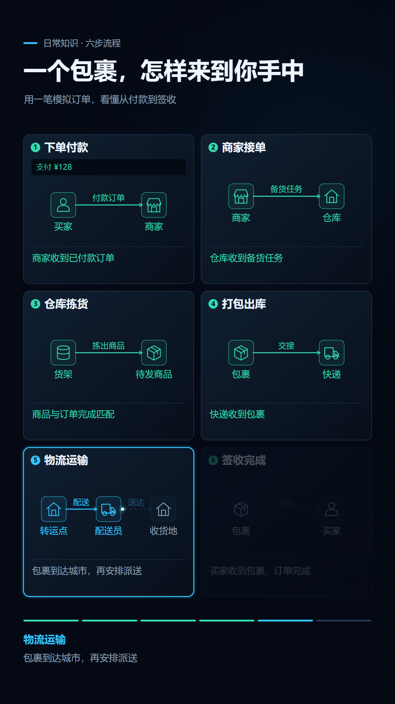

<div align="center">
  

  <p>
    <a href="skills/knowledge-motion/SKILL.md"></a>
    
    
    
    <a href="LICENSE"></a>
  </p>

  <p><strong>把知识变成看得懂的动态过程。</strong><br />
  将分类、流程与状态变化制作成深色动态信息图和静音视频，<br />
  同时保留可修改的动画源项目与分镜。</p>

  <p>
    <a href="https://resinya.github.io/knowledge-motion/">官网</a> ·
    <a href="https://resinya.github.io/knowledge-motion/examples">效果案例</a> ·
    <a href="https://resinya.github.io/knowledge-motion/docs/guide">使用指南</a> ·
    <a href="https://resinya.github.io/knowledge-motion/changelog">版本更新</a>
  </p>
</div>

## 它能做什么

固定分区保留知识全貌，逐步高亮引导视线，用路径、对象移动和数值变化说明每一步如何发生，完成的结果留在原处。

| 内容 | 动态表达 | 示例 |
| --- | --- | --- |
| 分类与速查 | 列表逐项聚焦，类别配色保持稳定 | [常见网络端口](https://resinya.github.io/knowledge-motion/examples#ports) |
| 连续过程 | 步骤依次亮起，对象沿路径传递 | [网购订单流程](https://resinya.github.io/knowledge-motion/examples#shopping) |
| 状态变化 | 操作与数值同步更新，保留变化记录 | [模拟家庭收支](https://resinya.github.io/knowledge-motion/examples#budget) |

## 安装

Codex：

```bash
npx skills add resinya/knowledge-motion --skill knowledge-motion --agent codex --global --copy
```

Claude Code 将 `codex` 改为 `claude-code`。去掉 `--global` 可安装到当前项目。安装后开启新会话，使用 `$knowledge-motion` 调用。

运行需要 Node.js 20.19+、FFprobe 与 Chromium 系浏览器。首次安装渲染依赖需要网络。

## 使用

提供主题或已有资料，也可以指定受众、时长与输出目录：

```text
用 $knowledge-motion 制作“网购订单从付款到签收的过程”，20 秒，输出静音 MP4。
把这份资料做成分类速查动画，保持整图可见，逐项聚焦。
用模拟账本演示家庭收入与支出怎样改变余额。
```

Skill 会提炼知识、选择布局、编排动作，先检查总览和关键画面，再渲染完整视频。默认采用 **9:16、1080×1920、30 fps、20 秒、无音轨**。

## 效果示例

一个模拟订单，从下单付款到签收完成，共六个固定分区。当前步骤亮起，光点沿路径移动，已完成步骤保留结果。

<p align="center">
  <a href="https://resinya.github.io/knowledge-motion/examples#shopping"></a>
</p>

[播放三条完整案例](https://resinya.github.io/knowledge-motion/examples)

## 交付内容

- **静音视频**：可播放、可分享的 MP4 成片。
- **动画源项目**：可继续修改的 Remotion 与 SVG 源码。
- **分镜与预览**：保留每一步的动作说明、关键画面与媒体检查结果。

所有产物保存在调用项目的输出目录中。详见 [Skill 说明](skills/knowledge-motion/SKILL.md)与[使用指南](https://resinya.github.io/knowledge-motion/docs/guide)。

Skill 自有代码采用 [MIT](LICENSE) 许可证；渲染依赖遵循 [Remotion 许可证](https://www.remotion.dev/docs/license)。
